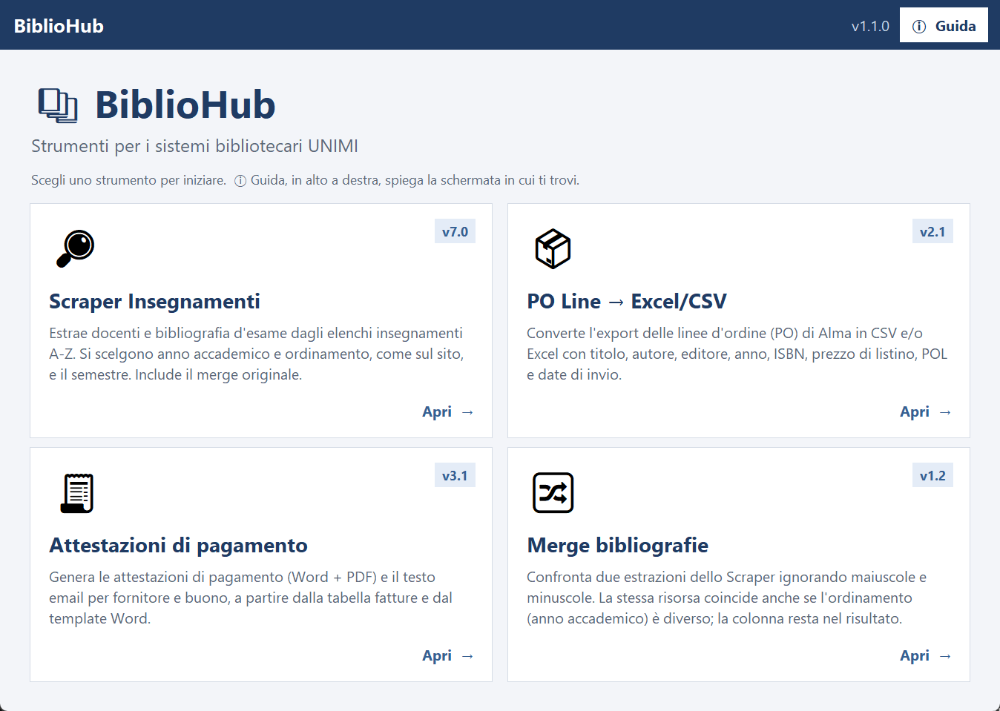
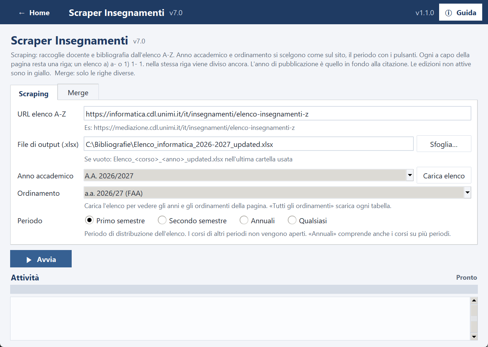
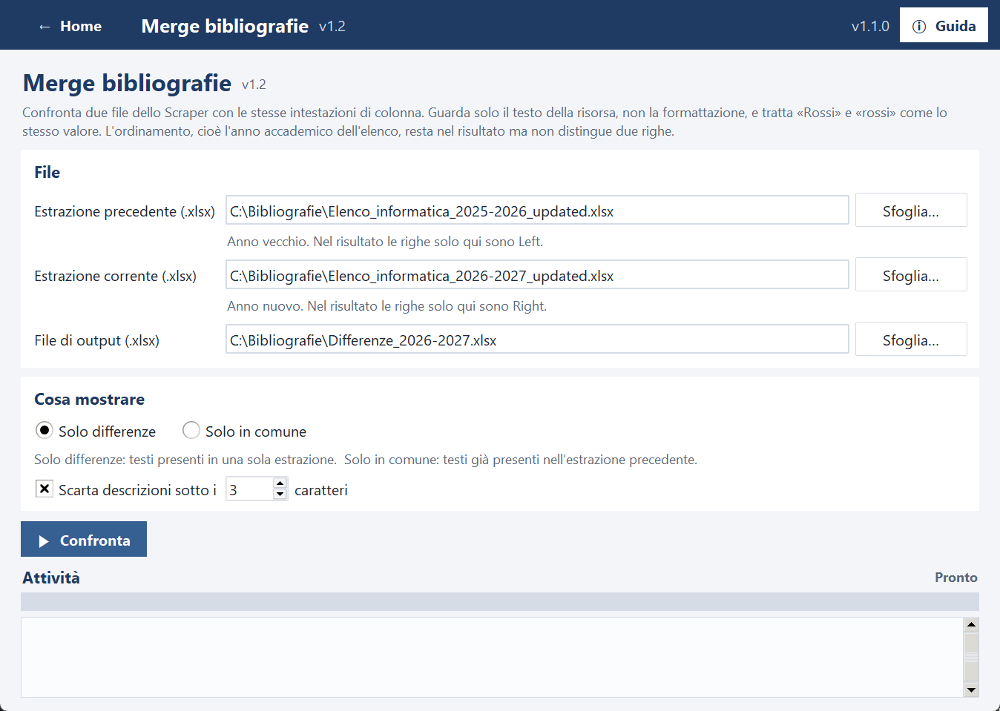
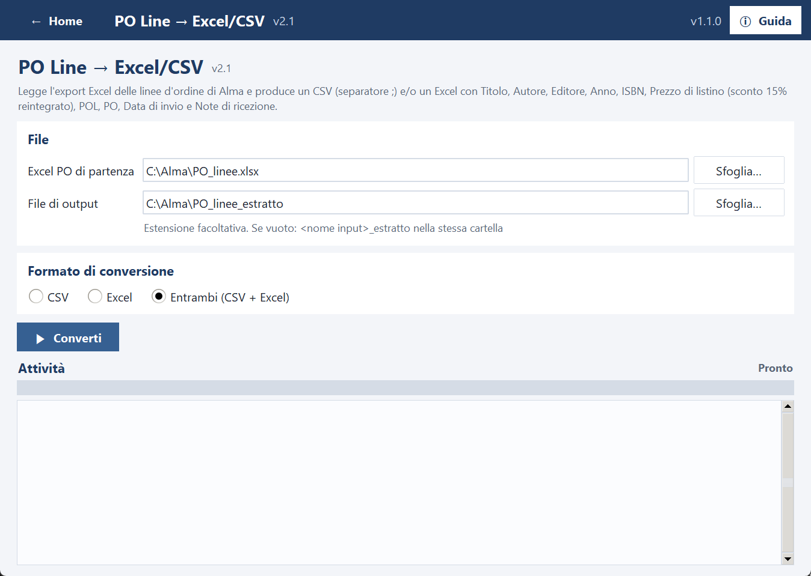
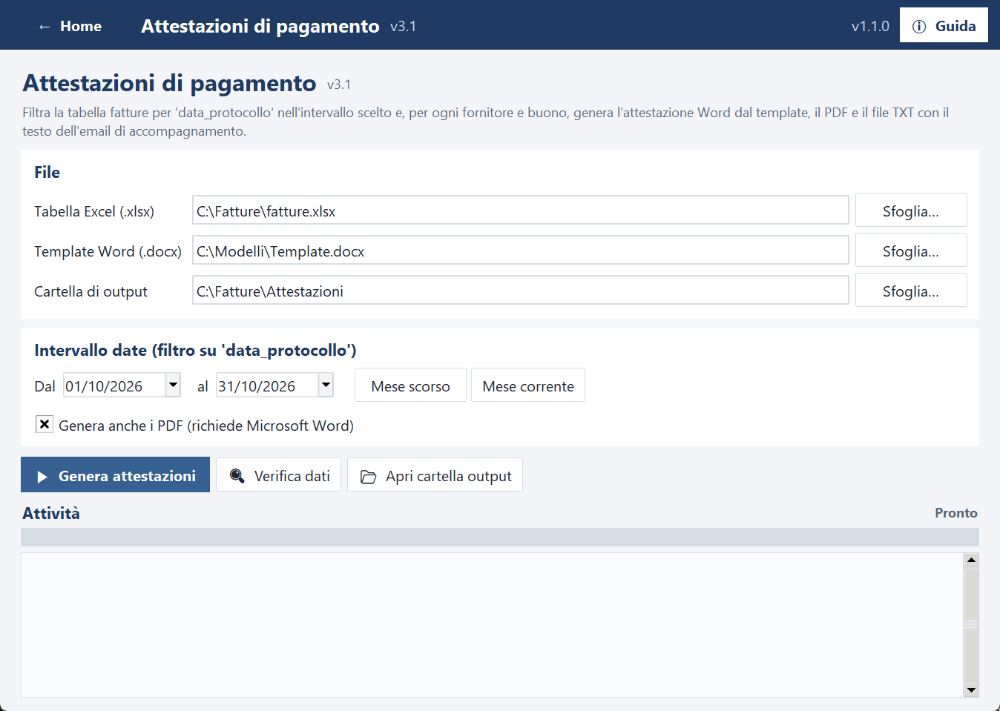

# BiblioHub

**Version 1.2.0.** Desktop tools for the library systems of the University of Milan. Exam bibliographies from the course catalogue, a match against the exam-copy register, Alma purchase orders, and payment attestations, in one window.

The window opens at 1100×640 and can be resized. The current release is [BiblioHub 1.2.0](https://github.com/Lesko02/BiblioHub/releases/tag/v1.2.0).

<p align="center">
  
</p>

The interface is Italian. **ⓘ Guida**, top right, explains the screen you are on.

The same manual can be read in the browser, without opening the app: [Manuale d'uso](docs/Manuale.md). GitHub renders that Markdown page, including the Topografie score and the inventory-date filter. A PDF of the same text is [`docs/Manuale_BiblioHub.pdf`](docs/Manuale_BiblioHub.pdf).

## Tools

| | |
|---|---|
| **Scraper Insegnamenti 7.0** | Reads an “Elenco insegnamenti A-Z” page and writes one Excel row per bibliography item: course, programme, period, edition, teacher, description, year, ISBN. Academic year and programme follow the site. Period is first semester, second semester, annual (including multi-period), or any. Course pages are fetched ten at a time. Inactive editions stay in the sheet, highlighted. The output file name carries the academic year. |
| **PO Line → Excel/CSV 2.1** | Turns an Alma PO-line export into CSV (semicolon, UTF-8 with BOM) and Excel. The price written out is the list price, with the 15% discount put back. |
| **Attestazioni di pagamento 3.1** | Filters an invoice table on `data_protocollo`. For each supplier and delivery note it writes a Word attestation from a template, a PDF through Microsoft Word, and the text of the covering email. |
| **Merge bibliografie 1.2** | Compares two scraper workbooks. Case is ignored, and the same resource matches even when the programme column differs. That column stays in the result. Differences are marked Left / Right; shared rows can be listed on their own. |
| **Topografie 1.1** | Matches one or more scraper workbooks to an Alma exam-copy register. Each citation is scored against the catalog title: rare words in the title count more, and the author counts for a smaller share. Matches above the threshold are written with shelfmark, barcode, and the course where the citation was found. Close calls go to a review sheet. An optional inventory date leaves out copies added on or after that day; a bare year means 1 January. |

The pictures below are Scraper, Merge, PO Line, and Attestazioni. Topografie is the fifth tool on the home screen; its score, gap, and inventory filter are in the manual.

<p align="center">
  
</p>

<p align="center">
  
  
</p>

<p align="center">
  
</p>

## Requirements

- Windows 10 or later
- [Python 3.11](https://www.python.org/downloads/windows/) or later, with **Add python.exe to PATH** selected
- Microsoft Word, only when attestation PDFs are requested

## Run

From the project folder:

```bat
pip install -r requirements.txt
python main.py
```

Settings are stored in `%APPDATA%\BiblioHub\settings.json`.

Regenerate the manual from `bibliohub/guide.py` with:

```bat
python docs/build_manual.py
```

## Layout

| Path | |
|---|---|
| `main.py` | Entry point |
| `bibliohub/tools` | The work. It does not depend on the window |
| `bibliohub/pages` | Screens |
| `bibliohub/registry.py` | The tool list and versions |
| `docs/Manuale.md` | The manual, also readable on GitHub |
